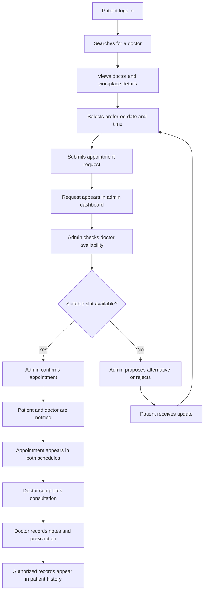
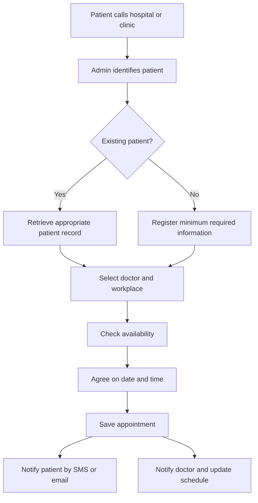
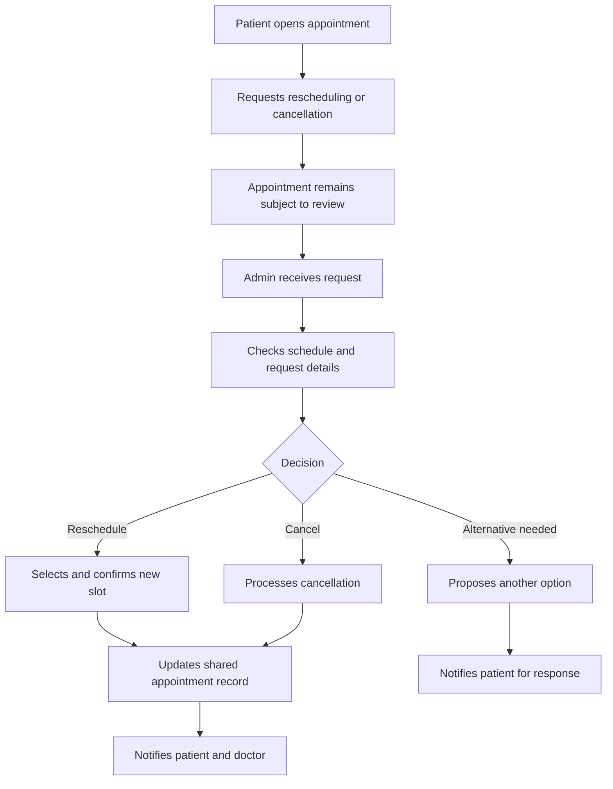
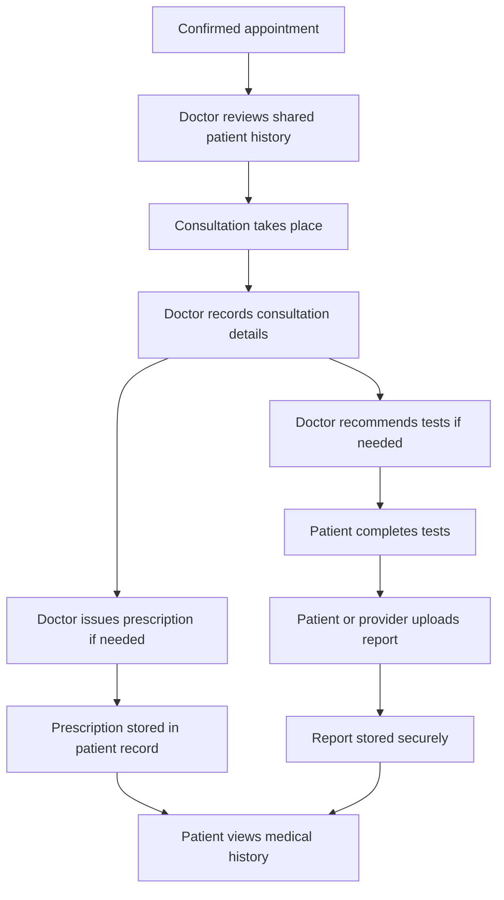
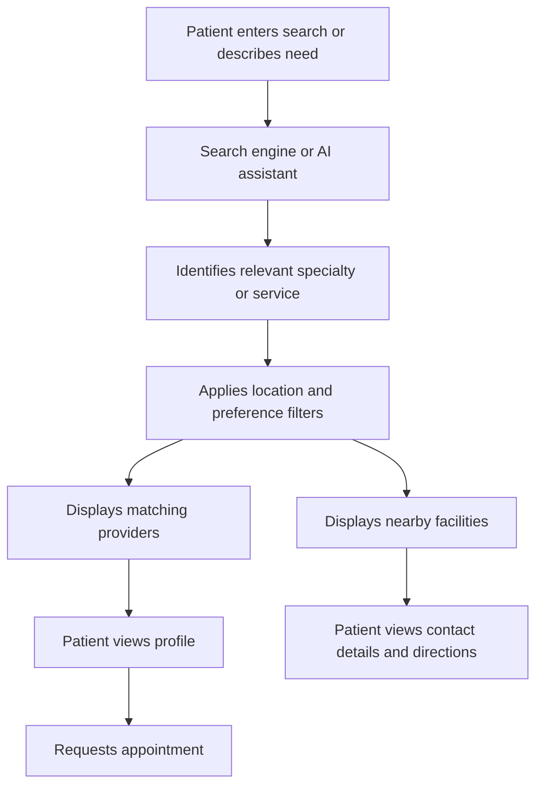
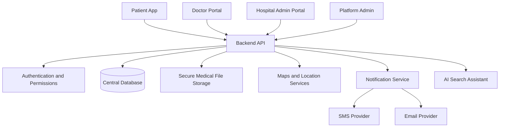

# Shastho Shohoj (স্বাস্থ্যসহজ)
### Making Healthcare Faster, Easier, and More Accessible

**Shastho Shohoj** is a proposed integrated healthcare platform designed to simplify how people in Bangladesh discover medical services, connect with healthcare professionals, book appointments, access emergency resources, and manage their medical records.

The platform aims to bring doctors, hospitals, clinics, diagnostic centers, pharmacies, patients, and healthcare administrators into one connected digital ecosystem.

Our goal is simple: **make healthcare easier to find, faster to access, and simpler to manage.**

---

## Table of Contents

- [Project Overview](#project-overview)
- [Problem Statement](#problem-statement)
- [Problems and Proposed Solutions](#problems-and-proposed-solutions)
- [Key Features](#key-features)
- [User Roles](#user-roles)
- [System Workflows](#system-workflows)
- [System Architecture](#system-architecture)
- [Technology Stack and Tools](#technology-stack-and-tools)
- [Expected Impact](#expected-impact)
- [Privacy and Security](#privacy-and-security)
- [Development Roadmap](#development-roadmap)
- [Future Enhancements](#future-enhancements)
- [Project Status](#project-status)
- [Contributing](#contributing)
- [License](#license)

---

## Project Overview

Finding the right doctor, identifying a nearby hospital, arranging an appointment, and keeping track of medical documents can be difficult when information is scattered across different platforms and physical records.

Shastho Shohoj aims to address these challenges through a centralized healthcare application that connects patients with medical professionals and healthcare facilities.

The platform is designed around five core principles:

- **Accessibility:** Help users discover healthcare resources near their location.
- **Efficiency:** Reduce the time and effort required to arrange appointments.
- **Coordination:** Connect patients, doctors, and hospital or clinic administrators.
- **Continuity of care:** Maintain organized medical histories, prescriptions, and diagnostic reports.
- **Emergency readiness:** Provide quick access to emergency contacts and nearby healthcare facilities.

The initial focus is doctor discovery and appointment management, with emergency assistance and digital medical records as essential parts of the broader platform.

## Problem Statement

Healthcare information, appointment scheduling, emergency contacts, and medical records are often fragmented across different providers and manual processes, making timely and coordinated healthcare access difficult for patients.

## Problems and Proposed Solutions

| Problem | Proposed solution |
|---|---|
| Difficulty finding suitable doctors | Search by name, specialty, symptoms, location, or healthcare facility. |
| Limited information about doctors | Display qualifications, specialties, experience, consultation fees, workplaces, and availability. |
| Uncertainty about nearby healthcare services | Provide location-based discovery of hospitals, clinics, diagnostic centers, and pharmacies. |
| Slow or confusing appointment booking | Introduce a centralized request, review, scheduling, and confirmation workflow. |
| Missed calls or disconnected communication | Send appointment updates to patients and doctors through in-app notifications, SMS, or email. |
| Appointment coordination difficulties | Give authorized administrators tools to coordinate doctor schedules and patient requests. |
| Patients without smartphones or app access during booking | Allow authorized hospital staff to create appointments on behalf of patients who call by phone. |
| Lost prescriptions and test reports | Maintain a secure digital repository for prescriptions, visit records, and diagnostic reports. |
| Difficulty reviewing previous medical information | Provide a chronological medical history accessible to patients and appropriately authorized healthcare professionals. |
| Delays in finding emergency resources | Offer quick access to nearby emergency hospitals, ambulance contacts, and urgent care information. |

---

## Key Features

### 1. Patient Portal

The patient portal is the main entry point to the platform.

- Patient registration and secure login.
- Personal profile with name, date of birth, age, phone number, email, and address.
- Location selection using a map-based address picker.
- Search for doctors, hospitals, clinics, diagnostic centers, and pharmacies.
- View appointment requests and confirmed appointments.
- Request rescheduling or cancellation.
- Receive appointment status updates.
- View previous visits, prescriptions, and medical test reports.
- Upload diagnostic reports and relevant medical documents.
- Manage emergency contacts and personal health information.
- Control access to private medical records.

### 2. Smart Doctor Discovery

Patients should be able to find appropriate healthcare professionals without needing to know exact medical terminology.

**Search options:**

- Doctor's name.
- Medical specialty.
- Hospital, clinic, or chamber name.
- Symptoms described in Bangla or English.
- Location and distance.
- Consultation fee and availability.

**Doctor profiles may include:**

- Name, photograph, qualifications, and specialty.
- Professional registration information, subject to verification.
- Experience and areas of practice.
- Consultation fees for individual workplaces.
- Chamber and hospital addresses.
- Professional appointment contact number.
- Available consultation days and time slots.
- Appointment request button.

#### AI-Assisted Healthcare Navigation

An optional AI assistant can ask simple questions to understand what kind of care a user is looking for.

It can help users identify relevant specialties, discover suitable healthcare facilities, and filter nearby doctors based on their preferences.

The assistant is intended for **healthcare navigation, not independent diagnosis or prescribing medication**. Urgent symptoms should be directed to appropriate emergency services rather than delayed by chatbot interactions.

### 3. Location-Based Healthcare Discovery

The platform aims to build a searchable directory of healthcare resources across Bangladesh.

Resource categories include:

- Hospitals and emergency departments.
- Doctors' chambers and private clinics.
- Diagnostic centers and laboratories.
- Pharmacies and medical stores.
- Ambulance providers and emergency contacts.

Users can search by name, service, specialty, and location.

Google Maps or a suitable mapping service can support address selection, directions, distance estimation, and map-based discovery.

Provider details, operating hours, contact numbers, and availability should be verified and updated regularly. Listings should not be presented as live or verified unless the underlying data supports those claims.

### 4. Emergency Assistance

The Emergency section prioritizes fast access to important services.

**Planned functions:**

- Quick access to Bangladesh's national emergency number, **999**.
- Nearby hospitals offering emergency care.
- Hospital contact information and directions.
- Ambulance contact and request options.
- Urgent doctor appointment requests where appropriate.
- Location sharing for assistance.
- Emergency request status and confirmation, when supported by participating providers.

A future ambulance integration could support pickup location, destination, provider acceptance, and live tracking.

Emergency hospital capacity and ambulance availability should only be displayed as live information when reliable integrations provide those data.

### 5. Appointment Management

The appointment system connects patients, doctors, and hospital or clinic administrators.

Patients can select a doctor, review available information, submit a preferred date and time, and track the request.

The request remains pending until an authorized administrator reviews it and coordinates scheduling.

Possible appointment statuses include:

- Pending review.
- Checking availability.
- Awaiting confirmation.
- Confirmed.
- Reschedule requested.
- Cancellation requested.
- Rejected.
- Completed.

The system should prevent conflicting bookings and keep all three parties synchronized when an appointment changes.

### 6. Hospital and Clinic Admin Portal

The admin portal is intended for authorized hospital or clinic employees responsible for appointment coordination.

**Dashboard**

- Pending appointment requests.
- Requests under review.
- Confirmed appointments.
- Completed appointments.
- Rescheduling requests.
- Cancellation requests.
- Doctor availability overview.

**Appointment operations**

- Review patient requests and preferred times.
- View relevant patient-provided symptoms and medical history, subject to authorization.
- Check doctors' schedules and workplace availability.
- Confirm an appointment at a specific time.
- Suggest an alternative time.
- Reject a request with an appropriate explanation.
- Process rescheduling and cancellation requests.
- Coordinate with doctors when availability changes.

**Phone-based appointment creation**

Patients who call a hospital or clinic should also be able to receive appointments through the same system.

An authorized administrator can:

1. Search for an existing patient using their phone number or another appropriate identifier.
2. Register a patient when necessary, with consent and appropriate verification.
3. Select the doctor and workplace.
4. Check available appointment slots.
5. Enter the agreed date and time.
6. Confirm and save the appointment.
7. Trigger notifications for the patient and doctor.

Phone bookings must use the same scheduling rules as online bookings to prevent duplicate appointments.

### 7. Doctor Portal

The doctor portal provides a separate workspace for medical professionals.

**Professional profile**

- Name, qualifications, specialty, and experience.
- Professional registration details.
- Email and relevant contact information.
- Workplaces, chambers, and hospital affiliations.
- Consultation fees and available hours.
- Professional appointment contact number.
- Relevant clinic or hospital administrator contact.

**Appointment dashboard**

- Today's schedule.
- Upcoming appointments.
- Pending requests requiring the doctor's input.
- Completed consultations.
- Patient details shared for an appointment.
- Schedule and availability management.

**Consultation workflow**

After a consultation, the doctor can mark the appointment as completed, add consultation notes, upload or issue a prescription, and record relevant follow-up instructions or recommended tests.

The system can then associate these records with the patient's medical history, subject to authorization and appropriate review.

### 8. Patient Medical Records

Shastho Shohoj aims to give patients a single, organized place for their medical information.

**Personal health information**

- Blood group, if provided.
- Allergies.
- Existing medical conditions.
- Current medications.
- Emergency contacts.
- Other relevant health information voluntarily provided by the patient.

**Doctor visit history**

- Visit date.
- Doctor and workplace.
- Consultation notes and diagnosis, when documented.
- Follow-up instructions.

**Digital prescriptions**

- Prescribing doctor.
- Issue date.
- Medication details and dosage instructions.
- Prescription document or digital record.

**Diagnostic reports**

- Test name and date.
- Diagnostic center.
- Uploaded report files.
- Relevant report metadata.
- View and download options.

Patients should be able to upload reports themselves, while authorized doctors can add records associated with their consultations.

Medical information must remain private and should only be shared with authorized parties for legitimate purposes.

### 9. Integrated Notifications

A centralized notification system should keep patients, doctors, and administrators informed.

Notifications may be delivered through:

- In-app notifications.
- SMS.
- Email.

Examples include:

- Appointment request received.
- Appointment confirmed.
- Alternative time proposed.
- Reschedule or cancellation request received.
- Appointment cancelled or rescheduled.
- Upcoming appointment reminder.
- Prescription or test report added.

The system should maintain a notification history and, where supported by the provider, delivery status.

A notification should clearly distinguish a submitted request from a confirmed appointment.

---

## User Roles

| Role | Primary responsibilities |
|---|---|
| Patient | Search for care, request appointments, manage personal information, and access medical records. |
| Doctor | Manage professional details, availability, appointments, consultation notes, and prescriptions. |
| Hospital/Clinic Admin | Review requests, coordinate schedules, create phone bookings, and manage appointment changes. |
| Platform Administrator | Manage platform-level accounts, permissions, provider verification, and system operations. |

Platform administrators and hospital administrators should have different permissions. Hospital staff should only manage the facilities and information they are authorized to access.

---

## System Workflows

### Workflow 1: Online Appointment Booking

### Workflow 2: Phone-Based Appointment Booking

### Workflow 3: Rescheduling and Cancellation

The system must handle simultaneous booking attempts safely and avoid assigning the same doctor's time slot to multiple patients.

### Workflow 4: Consultation and Medical Records

### Workflow 5: Smart Healthcare Discovery

---

## System Architecture

The proposed architecture uses a shared backend to connect the patient, doctor, and hospital admin interfaces.

The shared database maintains consistent appointment status, doctor availability, patient profiles, and medical records across all interfaces.

The backend should enforce role-based permissions, validate scheduling operations, and record important changes. Frontend controls alone are not sufficient to protect sensitive data.

---

## Technology Stack and Tools

The following is a recommended technology stack. Final choices should be confirmed during implementation.

| Area | Recommended technology or tool | Purpose |
|---|---|---|
| Frontend | HTML, CSS, JavaScript, React | Responsive patient, doctor, and admin interfaces |
| Mobile application | React Native or Flutter | Android and iOS applications |
| Backend | Node.js and Express.js | API endpoints and business logic |
| Database | PostgreSQL | Users, appointments, schedules, and structured medical records |
| Database prototyping | SQLite | Local development and early testing |
| Authentication | Secure sessions or established authentication libraries | Login, session management, and access control |
| Maps | Google Maps Platform or OpenStreetMap-based services | Address selection, locations, directions, and discovery |
| AI assistant | An appropriate language-model API | Natural-language search and healthcare navigation |
| File storage | Private object storage | Prescriptions, diagnostic reports, and uploaded documents |
| Notifications | SMS gateway, email provider, and in-app notifications | Appointment updates and reminders |
| Version control | Git and GitHub | Source code management and collaboration |
| Development environment | Visual Studio Code | Coding and debugging |
| API testing | Postman | Endpoint testing |
| Database management | DB Browser for SQLite or a PostgreSQL client | Inspecting and managing development data |
| UI/UX design | Figma | Wireframes, prototypes, and interface collaboration |
| Deployment | A suitable cloud hosting provider | Hosting the application and backend |
| Testing | Unit, integration, and end-to-end testing tools | Reliability and workflow validation |

### Important integrations

- A mapping provider for address search and location-based results.
- An SMS provider for phone-based appointment notifications.
- An email service for confirmations, reminders, and account communication.
- A secure file-storage service for medical documents.
- An AI service for search assistance, with appropriate safeguards and minimal data sharing.

These integrations may require paid accounts, API keys, provider agreements, and configuration. They should not be represented as operational until they have been connected and tested.

---

## Expected Impact

Shastho Shohoj is intended to improve healthcare access and coordination in several ways.

**For patients**
- Less time spent searching for suitable doctors and facilities.
- Easier access to consultation fees, locations, and available appointment information.
- Better communication about appointment changes.
- More organized medical histories, prescriptions, and diagnostic reports.
- Improved access to emergency contacts and nearby services.

**For doctors**
- Better visibility into upcoming appointments.
- More organized patient-shared medical histories.
- Easier recording of consultation outcomes and prescriptions.
- Improved coordination with hospital and clinic administrators.

**For hospitals and clinics**
- Centralized appointment request management.
- Fewer scheduling conflicts through shared availability rules.
- Support for both online and phone-based bookings.
- Better visibility into pending, confirmed, rescheduled, and completed appointments.

**For the healthcare ecosystem**
- A more organized digital directory of healthcare resources.
- Improved information flow between patients and participating providers.
- A foundation for future digital healthcare services across Bangladesh.

These are expected benefits, not yet measured outcomes. Their real impact will depend on adoption, provider participation, accurate information, and reliable implementation.

---

## Privacy and Security

Medical records and personal information require special protection.

The platform should implement:

- Secure authentication and role-based access control.
- Separate permissions for patients, doctors, hospital administrators, and platform administrators.
- Encryption in transit and appropriate protection of stored data.
- Secure password storage and session handling.
- Private storage for medical documents.
- Patient consent and controlled sharing of health records.
- Audit logs for sensitive actions and changes to appointments.
- Validation and access checks on every protected API endpoint.
- Data backups and a recovery process.
- Secure handling of API keys and environment variables.
- A process for correcting inaccurate provider listings and removing unauthorized access.

AI search should avoid unnecessary transmission of personally identifiable or sensitive medical information. AI-generated suggestions must not be treated as a substitute for professional diagnosis.

---

## Development Roadmap

The project should be developed in manageable phases.

### Phase 1 — Core Platform
- Project structure and database design.
- Patient registration and login.
- Doctor and healthcare facility profiles.
- Location-aware provider directory.
- Basic search and filters.

### Phase 2 — Appointment Management
- Appointment request submission.
- Hospital admin dashboard.
- Doctor availability and scheduling.
- Confirmation, rejection, rescheduling, and cancellation.
- Prevention of conflicting bookings.

### Phase 3 — Doctor Portal
- Doctor profile management.
- Today's schedule and appointment details.
- Patient-shared information.
- Consultation completion.
- Prescription and consultation record management.

### Phase 4 — Patient Medical Records
- Medical history timeline.
- Digital prescriptions.
- Diagnostic report uploads.
- Secure document access.
- Patient-controlled sharing and record permissions.

### Phase 5 — Integrated Communication
- In-app notifications.
- SMS and email notifications.
- Phone-based appointment creation by authorized admins.
- Appointment reminders and notification delivery tracking.

### Phase 6 — Emergency Assistance
- Nearby emergency facility discovery.
- Emergency contact access.
- Ambulance contact and provider integration.
- Location sharing and request tracking where supported.

### Phase 7 — AI and Expansion
- Bangla and English natural-language search.
- AI-assisted specialty discovery.
- Broader healthcare directory coverage across Bangladesh.
- Mobile application development.
- Performance, security, and usability improvements.

Each phase should be tested before moving to the next.

---

## Future Enhancements

Potential future improvements include:

- Live appointment availability from participating providers.
- Verified doctor and facility profiles.
- Map-based navigation with estimated travel times.
- Ambulance dispatch integration with real-time status.
- Online consultation and video appointments.
- Diagnostic test booking and results integration.
- Pharmacy inventory and medicine availability.
- Secure sharing of medical reports with selected doctors.
- Follow-up reminders and preventive-care notifications.
- Bangla-first accessibility improvements.
- Aggregated, privacy-preserving analytics for participating healthcare facilities.

Medicine ordering, payments, and online consultation should be introduced only after their operational, regulatory, and safety requirements are addressed.

---

## Project Status

Shastho Shohoj represents the planned direction of the project.

The initial development work has focused on the patient-facing web application and doctor discovery and appointment workflows. The broader features described in this README—including complete admin and doctor portals, automated notifications, AI-assisted search, nationwide provider coverage, and emergency integrations—should be considered planned until individually implemented and tested.

The README should be updated as each feature becomes operational.

## Contributing

Contributions, suggestions, and feedback are welcome.

A useful contribution process is:

1. Discuss the proposed feature or issue.
2. Create a separate branch for the change.
3. Implement the feature with appropriate validation and access controls.
4. Test relevant workflows.
5. Submit a pull request describing the change.

When working with test data, do not commit real patient records, passwords, API keys, private medical documents, or production database files.

## License

A license has not yet been specified. Choose an appropriate open-source or proprietary license before distributing the project publicly.

---

## Vision

**Shastho Shohoj — Healthcare should be easy to find, easy to access, and easier to manage.**

By connecting patients, doctors, hospitals, clinics, and diagnostic services through one coordinated platform, we aim to reduce avoidable friction in healthcare access and help people manage their health information with greater confidence.
